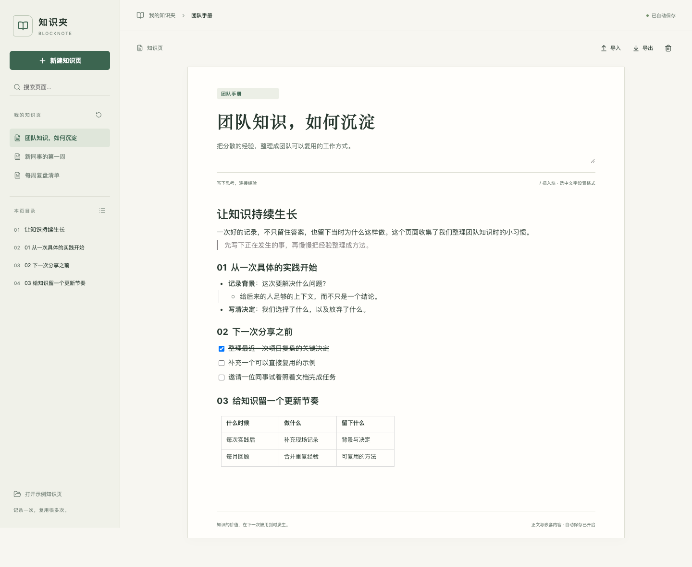

# BlockNote 知识夹

用块组织团队知识：写手册、整理实践记录、维护任务与表格。原生 BlockNote 编辑区搭配页面库和章节目录，正文随输入自动保存。

## 功能
- 标题、段落、引用、嵌套列表、任务、折叠列表、表格；原生 `/` 块菜单、选区工具与快捷键。
- 页面标题/分类/摘要、知识页搜索、目录跳转、空白与示例页面。
- SQLite 自动保存完整块 JSON；延迟响应不重建编辑器。离线本机副本、版本冲突保护、未完成导入输入恢复。
- 导入 JSON / 恢复副本 / Markdown / HTML 时新建页；导出完整 JSON、原生 Markdown、HTML 阅读页与完整恢复草稿。

## 使用与安装
在仓库根运行 `pnpm workbench prepare blocknote`，然后进入本目录运行 `pnpm dev`，打开输出的完整本地地址。`pnpm workbench:check` 和 `pnpm test` 验证源码；仓库根 `pnpm workbench package blocknote` 生成 `.fbworkbench`。

客户端安装入口：**Floatboat → My → Workbenches → Import workbench**。源包不带预览数据。Floatboat 桌面导入仍未验证。

## 边界
这是文字知识页工作台：不含远程媒体、附件、执行式 HTML、实时多人协作、AI 或 BlockNote 商业扩展。链接支持 http/https/mailto；导入 HTML 会去除非文字内容和事件。最多 1,200 块、8 层嵌套、100×12 表格，模型 700 KB，文本导入草稿 180,000 字符。完整 JSON 文件最多 4 MB，选择文件后直接导入为新页，按知识页/恢复副本结构校验，不受文本草稿框长度限制。JSON 保留完整块；Markdown/HTML 不保证全部视觉样式与折叠状态往返保真。本机恢复限定同一浏览器源。

## 验证
10 个领域/SQLite/自动保存测试；Chrome 实际原生编辑、勾选任务、表格输入、斜杠菜单、加粗、刷新恢复、延迟保存与继续输入、提交后丢失响应重试、失败恢复、无效草稿恢复、导入新页和版本冲突。导出文件经过独立内容断言。桌面 1440px、375px、深色和 reduced-motion 已通过浏览器验收，无页面脚本错误或横向溢出。证据脚本和临时输出保存在忽略的 `.cache/`。

## 来源与许可
精确依赖：`@blocknote/core` / `react` / `mantine` **0.56.0**（MPL-2.0），`@mantine/core` / `hooks` **9.0.2**（MIT），React **19.2.3**。无 XL/商业包。

[BlockNote 官方文档](https://www.blocknotejs.org/docs/getting-started)、[原生块](https://www.blocknotejs.org/docs/features/blocks)、[上游源码](https://github.com/TypeCellOS/BlockNote)。完整许可与来源见 [第三方声明](app/licenses/THIRD_PARTY_NOTICES.md) 和 [MPL-2.0](app/licenses/BlockNote-MPL-2.0.txt)。
