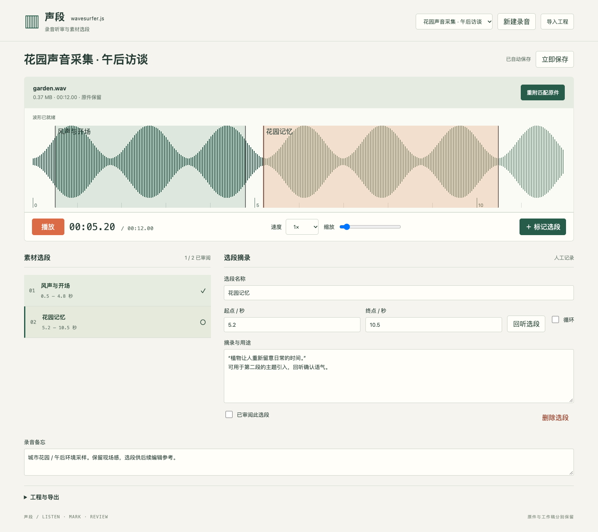

# 声段 · wavesurfer.js 工作台

录音听审与素材选段。真实 WaveSurfer 波形、速度与缩放、可拖动/输入的区间、循环回听、人工摘录和审阅标记。0.6.0，本地验收。

## 使用

上传支持的音频（单文件 ≤32 MiB），播放并标记选段；在摘录区记录人工文字，勾选已审阅。区间 JSON/CSV 供编辑参考，下载原音频保持原始字节。完整工程含原件与工作稿；恢复稿只含工作稿，缺失原件可按文件指纹重附。

自动保存保留未完成时间与未应用 JSON；导入总是新副本。原件累计占用随使用增长，源码包不包含业务音频。没有自动转录、剪切、降噪或邮件/外部服务功能。

## 开发与交付

仓库根目录运行 `pnpm workbench prepare wavesurfer-js`；本目录运行 `pnpm workbench:check`、`pnpm test`、`pnpm dev -- --no-watch`、`pnpm package`。固定模板和依赖锁定。客户端导入未验证；导入入口：Floatboat → My → Workbenches → Import workbench。

上游：https://github.com/katspaugh/wavesurfer.js · BSD-3-Clause。原创建集成代码 MIT，参见 app/LICENSE 与第三方 notices。

音频预算补充：原生metadata先限制10分钟；验证解码使用16kHz并检查128MiB PCM预算，原音频保持原始字节。输入上限与恢复契约一致；CSV公式前缀以文字转义。

正式模型按UTF-8计算850KB，恢复工作结构允许2MB；完整自动保存请求仍限制1.95MB。超过正式容量的内容保留为草稿，不覆盖最后确认的有效工程。引用原件的恢复稿在读取后重新核对真实时长；超出原件时长的区间和笔记继续保留，需修正后才成为有效工程。
