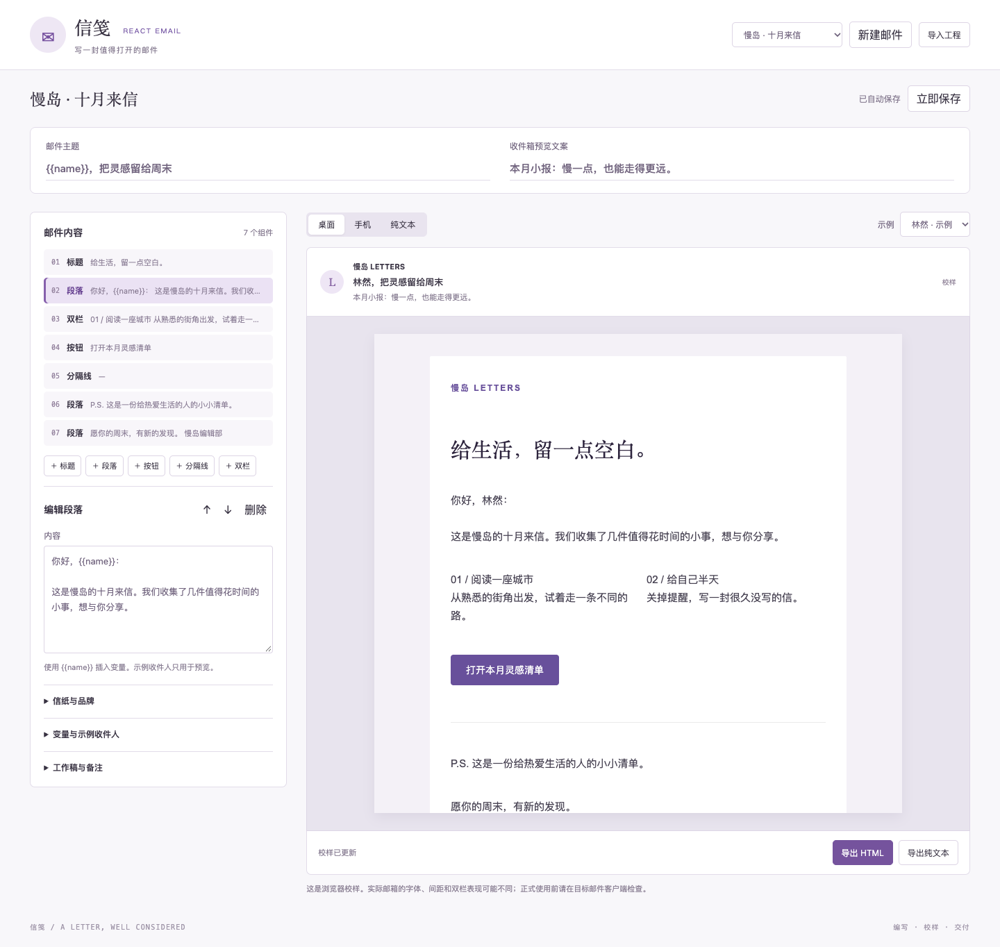

# 信笺 · React Email 工作台

一张邮件创作与校样桌：主题、预览文案、组件编排、变量与示例收件人替换，桌面/手机/纯文本校样，导出HTML、纯文本与完整工程。0.6.0。

## 使用

在左侧添加并排序标题、段落、按钮、分隔与双栏；用 {{name}} 这类变量写内容。示例收件人只用于校样，默认值可被示例值覆盖。右侧显示当前稿件的官方渲染结果，切换手机或纯文本检查。正式使用前在目标邮件客户端验证。

自动保存覆盖未完成链接/颜色/主题及未应用JSON；恢复稿按snapshot导入新副本，完整工程保留变量、示例、全部组件和编辑草稿。不会发送邮件或访问通讯录，没有任意JSX/eval。

## 官方实现路线

采用现役react-email@6.11.4固定commit中的12类官方组件与纯React工具，19源文件原样保留并转译为本地模块；官方@react-email/render2.1.1负责HTML与纯文本。统一CLI包含esbuild运行依赖，旧独立组件npm已deprecated，因此没有引入这些运行包。上游源/生成hash、MIT和可再生成配置均随源码包交付。详见app/ENGINEERING.md与app/third-party/NOTICE.md。

正式内容850KB，恢复结构2MB（覆盖1.95MB服务器请求容量内草稿），80组件，30示例；本地预览不承诺所有邮件客户端布局一致。字体与双栏需实际校验。

## 开发与交付

根目录 `pnpm workbench prepare react-email`，本目录 `pnpm workbench:check`、`pnpm test`、`pnpm dev -- --no-watch`、`pnpm package`。固定模板不改SDK/CSP，无模型或外部服务。客户端导入未验证；入口 Floatboat → My → Workbenches → Import workbench。

