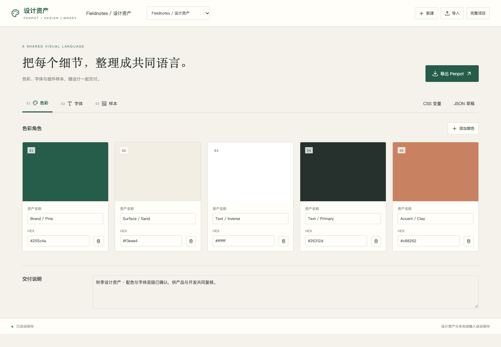

# 设计资产 · Penpot

把颜色、字体和组件样本整理成可交付的设计资产库，并用官方Penpot库生成原生文件。



- 色彩角色、字体层级、按钮/卡片样本编辑与样本册预览；样本关联真实资产引用。
- 自动保存完整项目与未完成色值/尺寸/JSON草稿；刷新恢复、导入新项目、版本冲突保护。
- 使用官方`@penpot/library@1.2.0`生成含颜色库、字体库、组件主实例和样本画板的原生`.penpot`包；可另导出CSS变量与完整JSON。
- 原生Penpot包导入提取支持的纯色和字体资产，作为新项目；明确不导入原生画板或复杂渐变/图像资产。

这是设计资产编排与交付工作台，不是完整Penpot编辑器、任意画板重建或多人协作平台。浏览器样本为CSS视图，原生包由真实官方库生成。字体定义保留家族/字号/字重，最终字体呈现依赖接收端字体。导出的包尚未在完整Penpot客户端里单独验收。

```sh
pnpm workbench prepare penpot
pnpm workbench check penpot
pnpm workbench test penpot
pnpm workbench dev penpot
pnpm workbench package penpot
```

无需独立Penpot服务器或模型账号。普通源码包不含预览项目；Floatboat → 我的 → 工作台 → 导入工作台。Floatboat客户端导入尚未实测。详细证据见[ACCEPTANCE.md](ACCEPTANCE.md)。

上游：[Penpot](https://github.com/penpot/penpot)、[官方Library](https://github.com/penpot/penpot/tree/develop/library)，MPL-2.0许可随声明资源保留。
