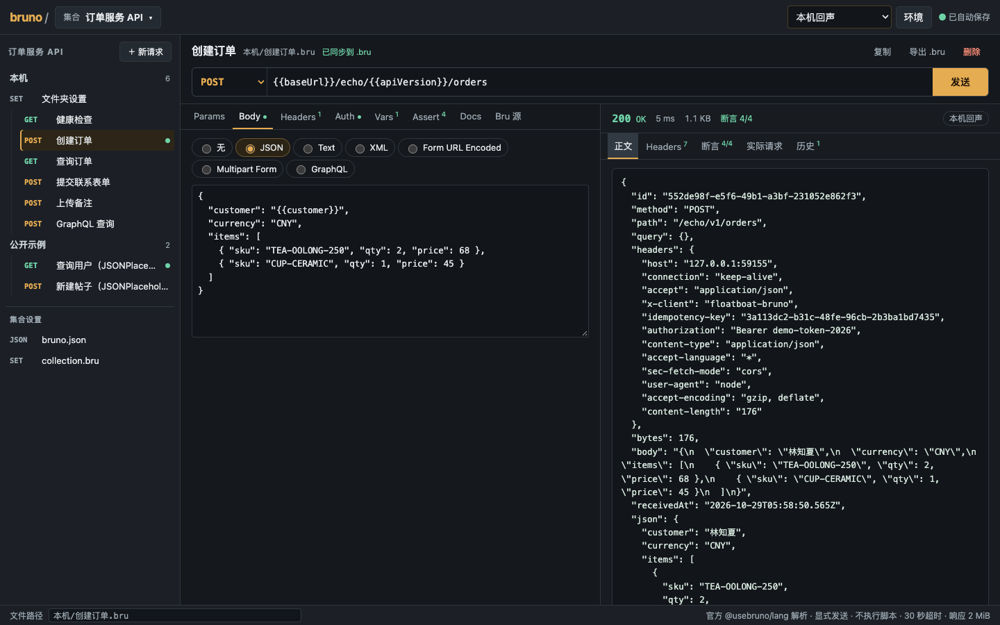

# Bruno 接口调试台

原生 `.bru` 请求/集合编辑、明确点击 HTTP 执行、响应状态/头/正文/时间检查与完整工程导出。集合侧栏可收起，请求和响应对照；完整工作稿自动保存，包含未应用参数、无效源码和响应快照。

使用官方 `@usebruno/lang@0.41.0` 解析/序列化。导入 `.bru`/`bruno.json` 文件或文件夹；原生集合 ZIP 解压后可重新导入。导出当前文件保留字节，完整工程和实际恢复稿均导入新副本。

`pnpm workbench prepare bruno` 后，在此目录运行 `pnpm dev -- --no-watch`。验证：`pnpm workbench:check`、`pnpm test`。打包：`pnpm run package`；Floatboat → My → Workbenches → Import workbench。默认包不含业务数据，客户端导入尚未验证。

容量边界：正式模型 780 KB；完整自动保存请求（含标题、编辑稿和协议字段）仍限 1.95 MB。工作结构恢复预算为 2 MB，覆盖已确认草稿的完整回读，不扩大可发送请求的上限。

执行边界：10 秒、64 KiB 响应正文、不自动跟随重定向或重发。脚本、tests、变量、认证/集合继承等仅保留原文并阻止运行；无环境秘密读取。手动输入和响应属于工程导出范围。完整说明见 [SETUP](app/SETUP.md)、[验收](ACCEPTANCE.md)。

[Bruno upstream](https://github.com/usebruno/bruno) · 原创集成采用范围限定 MIT，依赖保留各自许可。

