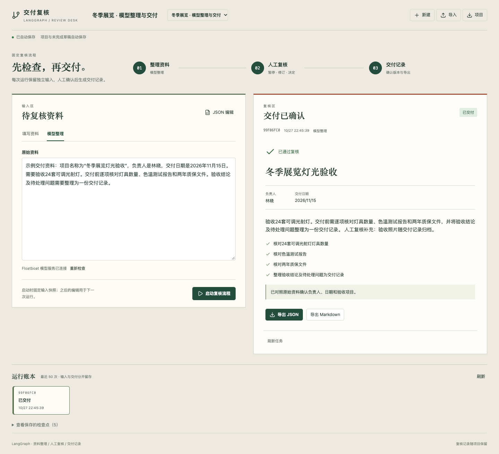

# 交付复核 · LangGraph

用真实 LangGraph 把资料整理、人工复核和交付分开。先填写资料或由 Floatboat 模型整理，在复核节点停下，修改并通过后生成独立的交付记录。



## 当前功能

- 主题、负责人、交付日期、摘要和检查事项；原文与未应用 JSON 草稿自动保存。
- 真实 `StateGraph` 三节点运行，`interrupt` / `Command` 人工复核，SQLite 检查点跨进程恢复。
- 通过、退回、取消、失败和中断状态；独立运行账本、输入快照、版本冲突与重复提交去重。
- 复核时修改字段和意见；生成结果不会覆盖左侧为下一轮编辑的资料。
- 交付 JSON / Markdown、项目 JSON 导入导出。导入创建新项目，不会重新执行导出的运行。
- 桌面双纸面复核区、横向流程与运行账本；窄屏顺序堆叠，支持键盘和 reduced-motion。

“填写资料”模式不调用模型，真实执行 LangGraph 的暂停/恢复流程。模型整理默认使用 `gemini-3.8-flash`，通过 Host `generateText` 调用，并在工作台严格验证 JSON 字段与完整结束状态。兼容单层 JSON 代码块；仍需运行兼容 Floatboat 并具备对应模型权限。连接不可用时明确显示原因，填写与复核仍可使用。

## 运行与打包

从总仓库运行：

```sh
pnpm workbench prepare langgraph
pnpm workbench check langgraph
pnpm workbench test langgraph
pnpm workbench dev langgraph
pnpm workbench package langgraph
```

预览使用本地 HTTP 和 SQLite。普通包只包含源码与依赖声明，不包含预览项目、检查点或凭证。导入路径：Floatboat → 我的 → 工作台 → 导入工作台。客户端导入尚未实测。

## 范围与证据

固定资料复核流程，不是完整的图编辑器、工具市场或通用 Agent IDE。模型步骤如果中断且没有已确认结果，不会自动重发；用户可以核查后显式发起新运行。

本地核心、保存恢复、浏览器与导出验证见 [验收记录](ACCEPTANCE.md)。实际模型成功调用和客户端导入分开记录，不用 mock 或页面可打开代替。

上游：[LangGraph.js](https://github.com/langchain-ai/langgraphjs)、[中断/恢复](https://docs.langchain.com/oss/javascript/langgraph/interrupts)、[持久化](https://docs.langchain.com/oss/javascript/langgraph/persistence)。锁定库为 MIT；许可原文保留在 [LangGraph](app/notices/langgraph-LICENSE.txt) 与 [Checkpoint](app/notices/langgraph-checkpoint-LICENSE.txt)。本项目未为整个总仓库另选统一许可证。
