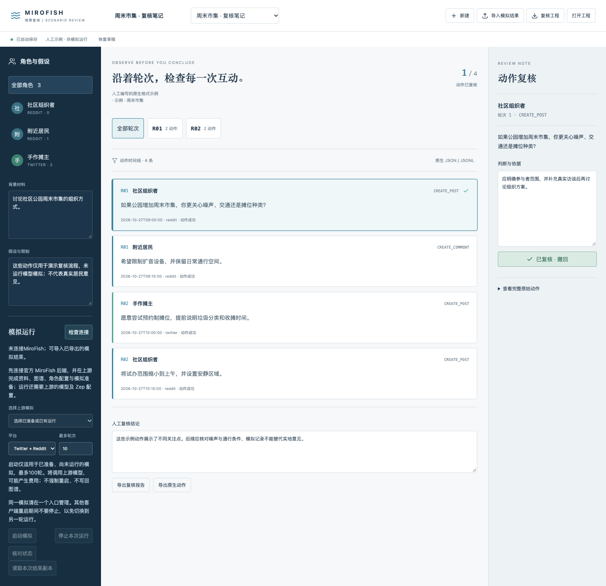

# 情景复核 · MiroFish

读取MiroFish已有模拟结果，按角色和轮次查看动作，记录假设、原始依据与人工判断，输出可追溯的复核报告。原始动作保持只读，批注与结论独立保存。


## 使用

```sh
pnpm workbench prepare mirofish
pnpm workbench dev mirofish
```

支持导入：官方`GET /api/simulation/<id>/run-status/detail`响应的`all_actions`、`/actions`响应、动作数组和`actions.jsonl`。JSONL里没有platform时需选择来自Twitter还是Reddit日志；`event_type`元事件按官方解析逻辑跳过，动作不会自动去重。单独`recent_actions`状态快照可能缺历史，因此拒绝把它当完整结果。

支持500条动作、850KB原生文件。超出容量请按轮次拆分；导入失败时原文本留在可自动保存的草稿中，不截掉内容后冒充完整数据。

## 工作流

1. 导入模拟结果或在“原生JSON/JSONL”中粘贴，读取为新项目。
2. 查看背景、假设与角色；按轮次/角色筛选，逐条记录批注并标记复核。
3. 汇总人工结论，导出Markdown报告、原生动作JSON或完整复核工程。

完整工程包含原始动作、角色说明、批注、未应用JSON和筛选状态；导入创建新项目。自动保存、IndexedDB本机恢复与冲突保护默认启用。也可通过“打开工程”将导出的恢复草稿读回为新编辑副本，不复用旧保存回执或项目身份。

## 可选官方服务

默认查找`http://127.0.0.1:8789`。通过`MIROFISH_URL`指定官方MiroFish服务；远程要求HTTPS。`MIROFISH_TOKEN`仅用于可选反向代理Bearer认证，不是Zep或模型凭据。健康检查确认`MiroFish Backend`后，可选取已有模拟并读取结果副本；列表显示前100项。

工作台可显式启动已准备且尚未运行的模拟，停止本次运行并读取结果；真实执行由官方后端及其模型/Zep配置负责。工作台不重建图谱或执行资料预处理。本次没有配置真实运行服务，也没有将HTTP fixture或人工例子当作真实模拟。首页示例明确标记为人工编写，仅用于学习复核操作。模拟文本不等于已经验证的现实预测。

上游锁定阅读提交`7657031ac01184afe2cb220f5ee3545573b5e843`，字段依据`AgentAction.to_dict`、日志解析器和官方API。可复核原始序列化器：`python3 scripts/verify-upstream-contract.py /path/to/MiroFish`。这只验证字段格式，不运行模拟。

打包：`pnpm workbench package mirofish`。导入：Floatboat → 我的 → 工作台 → 导入工作台。普通包不含预览数据、模型或上游部署；客户端导入尚未实测。[验收记录](ACCEPTANCE.md)单列实际范围。上游AGPL-3.0原文保留在`app/notices/`。

## 启动与观察模拟

连接官方后端后，在左侧“模拟运行”选择已经准备的模拟，选择平台和最多轮次（1–100），再点击“启动模拟”。启动会调用上游模型，可能产生费用。只允许ready且无历史运行的模拟首次启动；已有运行可观察、停止并读取结果，不提供强制重启或图谱写回。

每个命令先写入自动保存草稿，再由本地SQLite记录，随后只尝试一次上游POST。丢失回执或服务重启后只读取状态，不自动重发。相同本地命令编号不可更改参数；同一模拟的启动及同一轮停止也不会因新编号再次发送。原生上游没有幂等键或独立run_id，以simulation_id与started_at辨认运行；“观察到运行”不等同于证明某个未知命令已被接收。

停止前核对started_at，返回结果也核对本次身份。上游停止接口仅接受simulation_id，无法原子保证“状态核对后其他客户端立刻重启”的情况，所以请在单一入口管理同一模拟。迟到的同轮次状态不能将终态改回运行中。

完整工程或恢复稿导入仅作为新编辑副本，命令信息留作只读来源，不重放运行。未连接服务时运行按钮不可用，提示先完成官方后端、模型/Zep与模拟准备。命令待核对时不能悄悄切换项目或导入覆盖。



实际验证与接口限制见[运行接入](RUN-INTEGRATION.md)。
